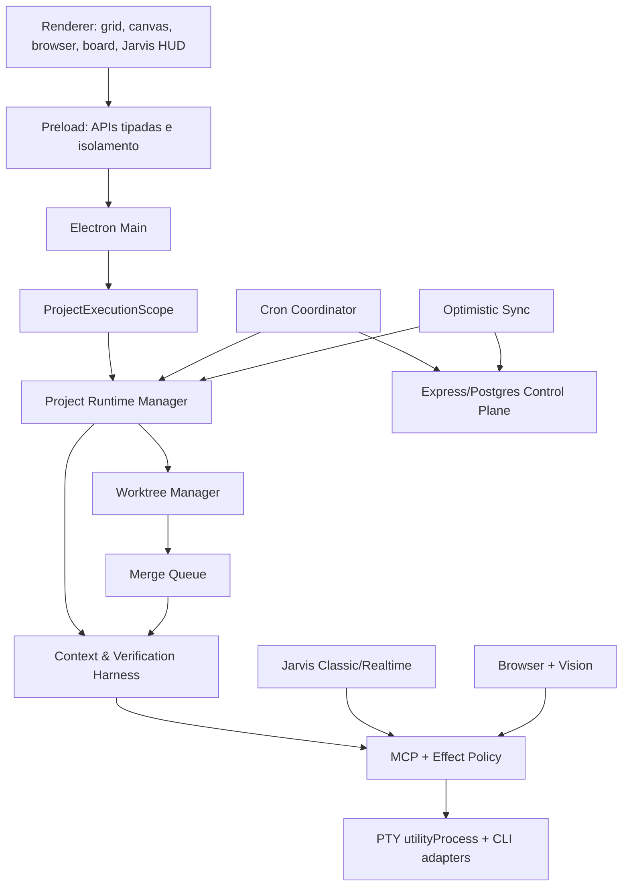

# Nexus IDE × ORCA — mapa completo de estado e integração

**Data do snapshot:** 2026-07-10  
**Repositório Nexus:** `/Users/cleofasrocha/dev/nexus-ide`  
**Branch analisado:** `fix/mic-permission-v011`  
**HEAD Nexus:** `16516a02a4707388acc023eaf4ab06d7414c5adb`  
**ORCA analisado:** `stablyai/orca@143c36e566483006fe54fa2716b019ec00599752`  
**Versão ORCA no snapshot:** `1.4.133`  
**Tipo de análise:** somente leitura, incluindo alterações não commitadas  
**Objetivo:** separar o que está pronto do que ainda está em construção e definir como reutilizar código real do ORCA sem substituir os diferenciais arquiteturais do Nexus.

---

## 1. Veredito executivo

O ORCA pode economizar meses de engenharia para o Nexus, principalmente em:

- confiabilidade e performance de terminal;
- segurança operacional de worktrees;
- recuperação de crashes do Electron/Chromium;
- SSH, WSL e execução remota;
- source control e integrações com forges;
- protocolo remoto e companion mobile;
- compatibilidade macOS, Windows e Linux.

A estratégia recomendada é **colheita seletiva de módulos vendorizados**, e não merge dos repositórios, fork integral ou substituição do core Nexus.

O Nexus já está construindo um núcleo que deve permanecer dominante:

- Jarvis e operação por voz;
- MCP auditável e com política de efeitos;
- identidade portátil de projeto/checkout;
- contexto versionado e atestado;
- contratos e workflow PREVC;
- sensores executados pelo Nexus;
- evidência vinculada a commit, diff, contrato e contexto;
- Review Council independente;
- worktrees com ownership;
- merge queue serializada e revalidada;
- cron e sync distribuídos.

O ORCA é mais maduro na infraestrutura ao redor desse core. Portanto:

> **Nexus continua sendo o produto e a arquitetura. ORCA vira fonte pinada de módulos de infraestrutura, testes e casos de borda.**

---

## 2. Fontes de verdade e método

A análise combinou:

1. histórico e referências Git do Nexus;
2. diff completo do working tree, incluindo arquivos novos;
3. documentação e specs locais;
4. grafo existente em `graphify-out/graph.json` para localizar relações entre subsistemas;
5. leitura direta dos módulos novos de runtime, contexto, worktrees, cron e sync;
6. `typecheck` e suíte completa de testes do Nexus;
7. clone do ORCA no commit exato informado acima;
8. leitura de licença, manifestos, arquitetura e módulos candidatos do ORCA.

### Limite do grafo existente

O grafo do Graphify foi útil como índice dos fluxos entre main, preload, renderer, MCP, voz, browser, persistência e terminal. Ele não foi tratado como autoridade para o working tree, pois parte do código não commitado é mais recente que o grafo. Para o estado atual, prevaleceram:

1. diff real;
2. arquivos no filesystem;
3. testes e typecheck;
4. documentação do mesmo snapshot.

---

## 3. Estado Git do Nexus

### 3.1 Linha de release

| Estado | Referência | Situação |
| --- | --- | --- |
| Release oficial mais recente | `v0.11.0` | Tag existente e presente em `origin/main` |
| Código v0.12.0 | `16516a0` | Commitado e enviado ao branch remoto de fix |
| `origin/main` | `c2ebe92` | Um commit atrás do branch analisado |
| Tag `v0.12.0` | inexistente | Ainda precisa ser criada após promoção |
| Working tree pós-v0.12 | não commitado | Nova arquitetura ampla em desenvolvimento |

O branch analisado está **1 commit à frente de `origin/main`** e sem divergência na direção contrária.

### 3.2 Working tree

Snapshot atual:

- 327 entradas no `git status`;
- 209 arquivos rastreados modificados;
- 1 arquivo rastreado removido;
- 117 arquivos não rastreados;
- 210 arquivos no diff rastreado;
- 21.512 linhas adicionadas;
- 7.031 linhas removidas.

Os números brutos incluem refactors e churn de formatação, mas a mudança funcional é, de fato, arquitetural.

### 3.3 Três níveis de prontidão

#### Nível A — release oficial

`v0.11.0`, já em main/tag.

#### Nível B — implementado e commitado, ainda não promovido

`v0.12.0`, presente no commit `16516a0`, mas ainda fora de `origin/main` e sem tag própria.

#### Nível C — implementado somente no working tree

Nova fundação de projeto, contexto, autonomia verificável, worktrees, merge, cron, sync e cross-platform. Possui cobertura de testes relevante, mas os gates ainda não estão verdes.

---

## 4. O que já está pronto no Nexus

### 4.1 Terminal e workspace

- Grid de terminais reais com PTY.
- Split, foco, resize e sessões persistentes durante reshape.
- Canvas infinito com os mesmos panes.
- Instância xterm longa por pane.
- Pool limitado de WebGL com fallback DOM.
- Busca, serialização, drag/drop de arquivos e paste de imagens.
- Processo nativo de PTY separado em `utilityProcess`.
- Idle/busy state para panes e orquestração.

### 4.2 Providers e CLIs

- Adapters declarativos.
- Claude, Codex, AGY, Kimi, Grok, Aider e OpenCode.
- Modelos, effort, permissões e argumentos extras.
- Descoberta de binários e PATH do shell de login.
- Multi-conta.
- Failover de conta/provedor.
- Resume de sessão quando suportado.
- Credenciais protegidas no Keychain/safe storage.

### 4.3 Orquestração

- Squads e papéis de orquestrador/worker.
- Missões persistidas.
- Handoffs persistidos e entregues quando o orquestrador fica idle.
- Todos e milestones.
- Pane registry e autorização entre panes.
- Pipes de saída entre panes.
- Spawn de agentes por adapter.
- Watchdog de stall.
- Cost tracking e usage tracking.
- Catálogo de agentes, skills e instalação multi-CLI.

### 4.4 MCP e segurança de tools

- Servidor MCP embutido.
- Token individual por agente.
- Tools `nexus_*` para panes, arquivos, Git, terminal, browser, media, visão, missão, handoff, catálogo e sync.
- Allowlist de tools/skills.
- Gate server-side e feedback client-side.
- Validação Zod em boundaries.
- Confirmação para efeitos de alto impacto.
- Redação de logs e auditoria.
- Política default-deny para tools novas.

### 4.5 Browser e visão

- Browser pane via `WebContentsView`.
- Navegação e estado.
- Políticas de URL e rede.
- Automação por refs opacas.
- Read, inspect, click, fill, wait e screenshot.
- Captura de tela do Nexus.
- AX tree.
- OCR.
- Contexto visual para Jarvis/agentes.
- Consentimento temporário para imagem.

### 4.6 Jarvis e voz

- Classic STT → brain → action → TTS.
- OpenAI Realtime e Gemini Live.
- Wake word e PTT.
- Barge-in.
- Recuperação de mute/status preso.
- Detecção de permissão TCC fantasma.
- Confirmação por voz para delegação.
- Tool calls realtime auditáveis.
- Fallbacks de STT/TTS/provider.
- Prova correlacionada de playback no renderer.
- Seleção de input/output de áudio.
- Observabilidade de latência, turn id e playback.

### 4.7 Produto e SaaS

- OAuth Google/GitHub.
- Sessão e refresh rotation.
- Billing Stripe.
- Plano Pro/Team.
- Times, convites e assentos.
- Licença assinada.
- Gamificação, XP, streaks e achievements.
- Ops Board.
- Auto-update.
- Assinatura e notarização macOS.

---

## 5. O que está sendo construído no working tree

### 5.1 Identidade portátil de projeto v2

Arquivos centrais:

- `src/shared/project-types.ts`
- `src/main/persistence/project-identity.ts`
- `src/main/persistence/project-git-lineage.ts`
- `docs/project-identity-v2.md`

Capacidades:

- `projectId` estável.
- Prova de origem por hash normalizado do remote.
- Root commits e anchor commits.
- Compatibilidade com clone full e shallow.
- Quarentena de manifesto v1.
- Checkout token fora do repositório.
- Detecção de cópia/duplicação de checkout.
- Separação entre instalação, projeto, checkout e path local.

Esta camada é boundary de autorização, não somente metadata.

### 5.2 Project Runtime Manager

Arquivos centrais:

- `src/main/runtime/project-runtime-manager.ts`
- `src/main/runtime/project-runtime-schema.ts`
- `src/main/runtime/project-runtime-migrations.ts`
- `src/main/runtime/sqlite-workflow-state-stores.ts`

Capacidades:

- SQLite por `projectId + checkoutId`.
- Abertura lazy.
- Limite de runtimes ativos.
- Lease/refcount.
- Migrações com backup.
- `quick_check`.
- Modo `safe-read-only` em falha.
- Proibição de fallback silencioso para memória.

### 5.3 Escopo por projeto em todo runtime

Mudanças transversais em:

- persistência;
- panes e spawn;
- terminal;
- browser;
- voz e visão;
- gamificação;
- usage/cost;
- missões, handoffs, todos e squads;
- renderer broadcasts;
- arquivos e editor;
- cron e sync.

O princípio central é:

> O workspace visível na UI não pode alterar a autoridade de uma execução já criada.

### 5.4 Context & Verification Harness

Diretório principal: `src/main/context/`.

Componentes:

- Context Ingestor.
- Truth Graph.
- Ambiguity Engine.
- Context Draft Store.
- Reviewer independente para drafts.
- Context Attestation.
- Context Doctor.
- Symbol Index.
- Snapshot Compiler.
- Contract Compiler.
- PREVC Engine.
- Sensor Broker.
- Automated Review Session.
- Review Council.
- Event/Evidence Ledger.
- Git binding.
- Merge Validation Coordinator.
- Sync Engine.

Invariantes relevantes:

- autor não aprova sua própria evidência;
- evidência se vincula a base/head/diff/contrato/contexto;
- alterar o diff invalida evidência anterior;
- CRITICAL/HIGH bloqueiam integração;
- executor não altera contexto/authority;
- falha de persistência crítica fecha o sistema;
- IA não recebe `force` administrativo.

### 5.5 Worktree Manager

Arquivos centrais:

- `src/main/runtime/worktree-manager.ts`
- `src/main/runtime/worktree-contract.ts`
- `src/main/runtime/worktree-state.ts`
- `src/main/runtime/worktree-runtime-registry.ts`

Capacidades:

- worktree por missão/tarefa/worker;
- branch interna determinística;
- ownership de files/symbols/domains;
- detecção de overlap;
- dependências entre tarefas;
- proteção de `.context` e `.nexus/project.json`;
- estado persistido com CAS;
- rejeição de Git config executável local;
- exigência de base limpa e HEAD congelado;
- preparação de candidato de integração.

### 5.6 Merge Queue

Arquivos centrais:

- `src/main/runtime/merge-queue.ts`
- `src/main/runtime/merge-queue-contract.ts`
- `src/main/runtime/merge-queue-state.ts`
- `src/main/runtime/merge-queue-recovery.ts`

Capacidades:

- serialização por projeto/checkout;
- validação em checkout destacado;
- fast-forward exato;
- compare-and-swap sobre HEAD;
- revalidação pós-integração;
- bloqueio durável em conflito/falha;
- recuperação após interrupção/crash;
- retry somente após mudança relevante ou acknowledgement controlado.

### 5.7 Nexus Doctor

Arquivos centrais:

- `src/main/runtime/nexus-doctor.ts`
- `src/main/runtime/nexus-doctor-bootstrap.ts`
- `src/main/runtime/nexus-doctor-capability-checks.ts`
- `src/main/runtime/nexus-doctor-context-check.ts`
- `src/main/runtime/nexus-doctor-sensor-check.ts`

Gates:

1. Git válido e configuração segura.
2. Manifesto v2 e linhagem verificável.
3. SQLite físico íntegro e gravável.
4. Context Doctor pronto.
5. Sensores mínimos.
6. Sandbox disponível.
7. Quórum de providers independentes.
8. Backend multi-PC quando prometido.
9. Permissões de filesystem.

### 5.8 Cron distribuído

Desktop:

- portable schedule definition;
- execution coordinator;
- durable execution state;
- backend HTTP opcional;
- lease por ocorrência;
- CAS de definição;
- local/shared explicitamente separados.

Servidor:

- `server/src/cron/cron-contract.ts`
- `server/src/cron/cron-service.ts`
- `server/src/cron/cron-routes.ts`
- migrations `0004_*`.

Garantias:

- relógio do servidor como autoridade;
- token de lease opaco, somente hash persistido;
- sem filesystem compartilhado;
- falha de backend fecha execução shared;
- schedule obsoleto não obtém lease.

### 5.9 Sync multi-PC

Desktop:

- `OptimisticSyncEngine`;
- backend HTTP com timeout e limite de resposta;
- publish por `expectedRevision`;
- conflito explícito, sem last-write-wins;
- filtro de payload sincronizável.

Servidor:

- `server/src/sync/sync-service.ts`
- `server/src/sync/sync-routes.ts`
- migration `0005_*`.

Dados sincronizáveis:

- mission metadata;
- context facts;
- context decisions;
- regressions;
- contract metadata;
- ledger metadata.

Dados proibidos:

- segredos, tokens e cookies;
- prompts e source code;
- provider/account sessions;
- paths e cwd;
- installation/checkout ids;
- objetos não JSON e payloads fora de budget.

### 5.10 Sandbox autônomo

Arquivos centrais:

- `src/main/runtime/process-sandbox.ts`
- `src/main/pty/autonomous-cli-policy.ts`
- `src/main/orch/mcp-effect-policy.ts`

Modelo:

- Seatbelt no macOS.
- Bubblewrap no Linux.
- Windows ainda falha fechado para execução autônoma confinada.
- Workers autônomos não herdam YOLO do usuário.
- Orquestradores/bootstrap ficam read-only em native tools.
- Efeitos passam pelo MCP auditado.

### 5.11 Release e multiplataforma

Em andamento:

- assinatura Windows;
- validação de certificado;
- Squirrel Windows assinado;
- smoke empacotado mais profundo;
- release workflow ampliado;
- endurecimento de mac signing/notarization;
- checks antes de package/make.

### 5.12 Voz em andamento

Novos módulos/testes indicam trabalho em:

- passive wake capture/matcher;
- score gate;
- PTT barge-in;
- AGC telemetry;
- full/half duplex policy;
- frame gate;
- follow-up gate;
- ownership realtime por projeto/janela;
- recuperação e handoff de microfone.

### 5.13 Live Design

Status: **planejamento, nada implementado ainda**.

Existe estudo completo e item executável:

- `TASK/items/VISUAL-EDIT-001.md`
- `docs/superpowers/specs/2026-07-10-edicao-visual-live-browser-design.md`

O Nexus possui cerca de 40% da fundação necessária, mas ainda faltam picker, overlay, contexto rico DOM→código e write-back.

---

## 6. Mapa arquitetural alvo do Nexus



### Fluxo de uma missão autônoma verificável


---

## 7. Resultado das validações do working tree

### 7.1 Typecheck

Comando:

```bash
npm run typecheck
```

Resultado: **falhou**.

Erro único observado:

```text
src/main/vision/ipc-bridge.ts(12,3): error TS6196:
'VisionContext' is declared but never used.
```

Classificação: bloqueio simples de compilação, provavelmente import residual.

### 7.2 Suíte completa

Comando:

```bash
npm test
```

Resultado:

- 352 arquivos de teste aprovados;
- 3 arquivos de teste com falha;
- 2.426 testes aprovados;
- 3 testes com falha;
- duração observada: 39,13 s de wall clock do runner, com execução acumulada maior entre workers.

### 7.3 Falhas analisadas

#### A. `tool-util-workspace.test.ts`

O código passou a enviar `executionScope` junto de `scope`, mas a expectativa antiga verifica somente:

```ts
{ adapterId, cwd, scope }
```

Diagnóstico: teste desatualizado. A nova propriedade é coerente com a separação entre coordination scope e task worktree execution scope.

#### B. `nexus-doctor-integration.test.ts`

A fixture cria `.nexus/project.json` com `schemaVersion: 1`, enquanto o Nexus Doctor corretamente quarentena manifesto legado.

Diagnóstico: fixture incompatível com a arquitetura v2. O manifesto real deste repositório já usa schema v2 e anchor/origin proof.

#### C. `merge-queue.test.ts`

O teste de serialização concorrente excedeu timeout de 5 segundos durante a suíte completa.

Reteste isolado:

- 16/16 testes passaram;
- teste afetado concluiu em aproximadamente 1,74 s;
- arquivo inteiro concluiu em aproximadamente 15,09 s.

Diagnóstico: flake/performance sob contenção global, não falha funcional determinística. Ainda precisa de correção para CI confiável.

### 7.4 Gates não executados nesta auditoria

- package completo;
- make/release;
- smoke do app empacotado;
- notarização real;
- assinatura Windows real;
- E2E visual/manual;
- deploy real de cron/sync;
- teste multi-PC real;
- teste de migração com banco de usuário real.

---

## 8. Higiene e riscos imediatos do working tree

### 8.1 `main.js` na raiz

Existe um `main.js` não rastreado, minificado, com cerca de 933 linhas físicas e linhas extremamente longas. É um bundle gerado, não source.

Riscos:

- commit acidental de artefato;
- confusão com `package.json#main`;
- código embutido antigo, incluindo schema de project identity v1;
- análise estática e busca poluídas;
- possível execução acidental por scripts humanos.

Ação recomendada:

- identificar o comando que o gerou;
- remover o arquivo do working tree;
- adicionar ignore específico se a ferramenta puder regenerá-lo na raiz;
- nunca corrigir o bundle manualmente.

### 8.2 Modelo ONNX não rastreado

Arquivo:

```text
.nexus/wake-candidates/speechkit-hey-jarvis.onnx
```

Antes de commit/distribuição, registrar:

- licença do modelo base;
- licença e origem do dataset;
- script/config de treinamento;
- métricas de false positive/false negative;
- hash do artefato;
- versão do runtime ONNX;
- permissão para redistribuição comercial;
- local final correto fora de metadata local de projeto, se for asset de produto.

### 8.3 Diff grande demais para um único commit

O working tree mistura:

- identidade v2;
- runtime SQLite;
- scope migration;
- context harness;
- worktrees/merge queue;
- cron/sync;
- voz;
- release;
- UI/CSS;
- server migrations.

Isso reduz auditabilidade e aumenta risco de regressão. A promoção deve ser fatiada por invariantes e dependências, não apenas por diretório.

---

## 9. Snapshot do ORCA

### 9.1 Identidade

- Repositório: `https://github.com/stablyai/orca`
- Commit: `143c36e566483006fe54fa2716b019ec00599752`
- Data do commit: `2026-07-10T21:57:09+02:00`
- Versão: `1.4.133`
- Licença: MIT
- Copyright: `Copyright (c) 2026 Lovecast Inc.`

### 9.2 Escala observada

- aproximadamente 7.689 arquivos rastreados;
- aproximadamente 7.603 arquivos no corpus localizado por busca;
- aproximadamente 6.409 arquivos em `src`;
- aproximadamente 2.849 testes;
- clone com cerca de 180 MB no snapshot analisado.

### 9.3 Stack relevante

- Electron 42;
- React 19;
- Node 24;
- pnpm 10;
- electron-vite;
- node-pty;
- xterm 6.1 beta;
- Zustand;
- Zod;
- Tailwind 4;
- SSH2;
- WebSocket;
- TweetNaCl;
- app mobile separado.

### 9.4 Capacidades principais

- worktrees paralelos;
- terminal splits;
- worktrees por SSH;
- mobile companion;
- CLI `orca` e modo serve/headless;
- Design Mode;
- GitHub, GitLab e outros forges;
- Linear e Jira;
- source control e diff review;
- agent hooks;
- WSL/PowerShell;
- terminal history e snapshots;
- crash recovery;
- updater cross-platform;
- themes Ghostty/Warp;
- runtime remoto e relay.

---

## 10. Nexus versus ORCA

| Área | Nexus | ORCA | Estratégia |
| --- | --- | --- | --- |
| Produto central | IDE multiagente + Jarvis + autonomia verificável | IDE para agentes paralelos por worktree | Manter identidade Nexus |
| Voz | Profundamente integrada | Secundária | Manter Nexus |
| MCP e tools | MCP nativo com policy/gates | Mais orientado a RPC/hooks | Manter Nexus |
| Contexto de negócio | Truth graph, context revisions, contratos | Não possui equivalente com a mesma autoridade | Manter Nexus |
| Evidência e review | Sensores, binding Git, Review Council | Reviews e status de agentes | Manter Nexus e importar UX operacional |
| Worktree core | Novo, rígido, orientado a contrato/evidência | Maduro, amplo e cross-platform | Manter core Nexus; copiar safety/edge cases |
| Terminal | Persistente, escrita direta no xterm | Scheduler, backpressure, snapshots e perf gates | Importar/adaptar ORCA |
| Crash recovery | Cobertura limitada | Circuit breaker, breadcrumbs e process diagnostics | Copiar ORCA |
| Remote | SSH+tmux e bridge inicial | Relay, filesystem, Git remoto, WSL | Adaptar em fase posterior |
| Source control | Tools Git básicas | Forge abstraction e review completo | Importar por provider |
| Mobile | Sem companion completo | Companion RPC/E2EE | Adotar após protocolo remoto |
| Cross-platform | Em construção | macOS/Windows/Linux maduros | Usar ORCA como fonte de casos de borda |
| UI | Design próprio do Nexus | Renderer e design system próprios | Não copiar renderer inteiro |
| Release | Forge/macOS, Windows em construção | electron-builder e matriz madura | Importar padrões, não config inteira |

---

## 11. Inventário de código ORCA para reaproveitamento

Todos os links abaixo estão pinados ao commit auditado.

### 11.1 Prioridade P0 — copiar/adaptar primeiro

#### A. Renderer Recovery Circuit Breaker

Fonte:

`src/main/crash-reporting/renderer-recovery-circuit-breaker.ts`

URL:

<https://github.com/stablyai/orca/blob/143c36e566483006fe54fa2716b019ec00599752/src/main/crash-reporting/renderer-recovery-circuit-breaker.ts>

Valor:

- impede loop infinito de reload do renderer;
- janela móvel de recovery attempts;
- pequeno, puro e determinístico;
- fácil de testar;
- pouco acoplamento com o restante do ORCA.

Modo de adoção: **cópia praticamente direta**, mantendo testes e attribution.

Destino sugerido:

```text
src/main/reliability/renderer-recovery-circuit-breaker.ts
```

Aceite:

- até N recoveries automáticos na janela;
- breaker abre após o limite;
- reload manual reseta;
- crash loop não consome CPU indefinidamente.

#### B. Worktree Removal Safety

Fonte:

`src/main/worktree-removal-safety.ts`

URL:

<https://github.com/stablyai/orca/blob/143c36e566483006fe54fa2716b019ec00599752/src/main/worktree-removal-safety.ts>

Proteções:

- recusa path vazio;
- recusa worktree principal;
- recusa `/`, home e pais perigosos;
- recusa apagar um pai contendo outro worktree registrado;
- não usa formato do path como prova de ownership;
- valida `.git` de órfão;
- protege symlink;
- exige provenance para limpeza de sobras não registradas.

Modo de adoção: **copiar algoritmo e testes; adaptar tipos/imports**.

Destino sugerido:

```text
src/main/runtime/worktree-removal-safety.ts
```

Integração Nexus:

- `WorktreeRecord` substitui `WorktreeMeta`;
- `ProjectExecutionScope.rootRealPath` fornece root;
- state store Nexus fornece provenance;
- remoção vira operação auditada e idempotente;
- execução somente após worktree estar terminal e fora da merge queue.

#### C. Terminal Stream Protocol

Fonte:

`src/shared/terminal-stream-protocol.ts`

URL:

<https://github.com/stablyai/orca/blob/143c36e566483006fe54fa2716b019ec00599752/src/shared/terminal-stream-protocol.ts>

Valor:

- frames binários;
- opcode;
- stream id;
- sequence number;
- output/input/resize/subscribe/snapshot/error;
- base para replay e detecção de perda.

Modo de adoção: **cópia direta com namespace Nexus**.

Destino sugerido:

```text
src/shared/terminal-stream-protocol.ts
```

Uso futuro:

- remote bridge;
- mobile companion;
- terminal history;
- reconexão;
- snapshot incremental;
- multiplexing de panes.

#### D. Terminal Output Scheduler

Fonte:

`src/renderer/src/lib/pane-manager/pane-terminal-output-scheduler.ts`

URL:

<https://github.com/stablyai/orca/blob/143c36e566483006fe54fa2716b019ec00599752/src/renderer/src/lib/pane-manager/pane-terminal-output-scheduler.ts>

Problema Nexus atual:

```ts
window.nexus.pty.onData(sessionId, (data) => host.term.write(data))
```

Com muitos agentes, essa escrita direta pode produzir:

- jank no renderer;
- backlog sem limite;
- terminais ocultos consumindo memória;
- atraso de input no terminal ativo;
- starvation do terminal em foreground.

O scheduler ORCA oferece:

- fila por terminal;
- prioridade foreground/background;
- time budget por drain;
- chunking;
- coalescing;
- limite de backlog;
- drop controlado com aviso;
- métricas de pressão;
- tratamento de cursor e synchronized output.

Modo de adoção: **adaptar máquina de estados e testes**, sem copiar cegamente imports ou internals de xterm beta.

Risco:

- ORCA usa xterm beta e helpers próprios;
- parte da recuperação usa internals de renderer do xterm;
- Nexus usa xterm estável.

Aceite:

- input foreground continua responsivo sob output concorrente;
- backlog hidden não cresce indefinidamente;
- ordem de output preservada;
- nenhum escape ANSI fica corrompido após chunk/drop;
- benchmark com 4–10 panes produtores.

### 11.2 Prioridade P1 — segunda onda

#### Crash reporting completo

Fontes ORCA:

- `process-gone-classification.ts`
- `process-gone-dedupe.ts`
- `process-gone-diagnostics.ts`
- `gpu-crash-fallback-decision.ts`
- `crash-breadcrumb-store.ts`
- `crash-report-store.ts`

Objetivo Nexus:

- distinguir renderer, GPU, network/audio utility e shutdown esperado;
- deduplicar alertas;
- preservar breadcrumbs bounded;
- coletar diagnóstico sem segredo;
- recuperar renderer sem loop.

#### Agent hooks e status

Fontes:

- `src/shared/agent-hook-types.ts`
- `src/shared/agent-hook-listener.ts`
- `src/main/agent-hooks/`
- `src/main/agent-awake-service.ts`

Valor:

- estado working/idle/finished mais confiável que parsing de terminal;
- suporte a providers distintos;
- notificações;
- prevenção de sleep durante trabalho;
- integração WSL/SSH.

Estratégia:

- mapear eventos ORCA para `PaneSessionState` e mission/task state do Nexus;
- não permitir que hook do provider seja autoridade de evidência;
- hook informa atividade, mas sensores Nexus continuam provando conclusão.

#### Hosted remote URL parser

Fonte:

`src/main/git/hosted-remote-url.ts`

URL:

<https://github.com/stablyai/orca/blob/143c36e566483006fe54fa2716b019ec00599752/src/main/git/hosted-remote-url.ts>

Valor:

- GitHub/GitLab/Bitbucket;
- HTTPS, SSH, SCP-like e shorthand;
- links de arquivo/linha e commit;
- módulo pequeno e testável.

Atenção de licença: o próprio arquivo informa ser fork local do comportamento de `hosted-git-info@9.0.3`. Registrar também essa provenance.

#### Forge provider abstraction

Fonte:

`src/main/source-control/forge-provider.ts`

URL:

<https://github.com/stablyai/orca/blob/143c36e566483006fe54fa2716b019ec00599752/src/main/source-control/forge-provider.ts>

Providers:

- GitHub;
- GitLab;
- Bitbucket;
- Azure DevOps;
- Gitea.

Estratégia:

- portar primeiro interface e mappers;
- implementar GitHub e GitLab;
- outros providers atrás de feature flags/adapters;
- toda escrita externa exige autorização explícita e logs.

### 11.3 Prioridade P2 — projetos maiores

#### SSH relay e runtime remoto

Fontes:

- `src/relay/`
- `src/main/ssh/`
- `src/main/providers/ssh-*`

Capacidades ORCA:

- PTY remoto;
- filesystem remoto;
- Git remoto;
- cancelamento/streaming;
- backpressure;
- handshake;
- Windows/WSL;
- automations remotas.

Estratégia Nexus:

- não substituir `remote-bridge` de uma vez;
- definir protocolo comum;
- portar transport e testes de segurança;
- manter `ProjectExecutionScope` local como autoridade;
- representar host remoto como capability explícita.

#### Mobile companion

Fontes:

- `mobile/`
- `mobile/src/transport/`
- `src/main/runtime/rpc/`
- terminal stream protocol.

Pré-requisitos:

1. protocolo remoto estável;
2. pairing seguro;
3. E2EE;
4. reconnect/resume;
5. authz por projeto/missão;
6. notificações;
7. política de revogação de dispositivo.

O mobile não deve ser importado antes do transport ser adaptado ao modelo de scopes do Nexus.

#### WSL e cross-platform avançado

Fontes:

- `src/main/wsl*.ts`
- PowerShell helpers;
- providers Windows;
- relay WSL;
- updater/release Windows/Linux.

Valor:

- normalização de paths;
- shell readiness;
- Git Bash/PowerShell;
- process detection;
- hooks dentro do WSL;
- update e packaging.

### 11.4 P3 — opcionais

- importação de themes Warp/Ghostty;
- Jira;
- Linear;
- automations externas;
- ephemeral VM runtime;
- advanced source-control UI;
- rich markdown/editor components;
- localization framework.

---

## 12. O que não deve ser copiado ou substituído

### 12.1 Não substituir o core de worktree Nexus

O worktree Nexus se vincula a:

- projeto/checkout;
- missão/tarefa;
- context revision;
- ownership;
- contrato;
- sensores;
- review;
- evidence ledger;
- merge queue.

O ORCA possui worktrees operacionais mais maduros, mas não o mesmo modelo de autoridade. Reaproveitar safety, recovery, parsing e UX; não trocar o core.

### 12.2 Não importar o renderer/store inteiro

Razões:

- design system diferente;
- React 19 versus React 18;
- Tailwind/shadcn versus CSS/tokens Nexus;
- store model e entidades diferentes;
- alto risco de perder identidade visual e fluxos Jarvis/Canvas/Ops.

### 12.3 Não copiar `package.json`, toolchain ou lockfile

Diferenças:

| Nexus | ORCA |
| --- | --- |
| npm workspaces | pnpm |
| Node 20–22 | Node 24 |
| React 18 | React 19 |
| Electron 43 | Electron 42 |
| xterm 6 estável | xterm 6.1 beta |
| Electron Forge | electron-builder/electron-vite |

Cada módulo deve ser adaptado às versões Nexus, não o contrário.

### 12.4 Não copiar comportamento administrativo incompatível

Nenhum código importado pode:

- permitir `force` acessível ao agente;
- tratar hook/provider como evidência suficiente;
- usar path como identidade;
- escrever fora de `ProjectExecutionScope`;
- persistir segredo em arquivo de projeto;
- executar ação externa sem policy/consentimento;
- concluir missão somente por exit code ou texto do agente.

---

## 13. Política de licença e provenance

### 13.1 Licença ORCA

O ORCA declara MIT:

<https://github.com/stablyai/orca/blob/143c36e566483006fe54fa2716b019ec00599752/LICENSE>

A licença permite uso, cópia, modificação, merge, publicação, distribuição, sublicenciamento e venda, desde que o copyright e o texto da licença acompanhem cópias ou porções substanciais.

### 13.2 Estrutura recomendada no Nexus

```text
THIRD_PARTY_NOTICES.md
third_party/
  licenses/
    orca-MIT.txt
  provenance/
    orca-143c36e.json
```

### 13.3 Cabeçalho recomendado em arquivo copiado/adaptado

```text
Adapted from stablyai/orca at commit
143c36e566483006fe54fa2716b019ec00599752.
Copyright (c) 2026 Lovecast Inc.
Licensed under the MIT License. See third_party/licenses/orca-MIT.txt.
Nexus changes: <resumo objetivo>.
```

### 13.4 Manifesto de provenance sugerido

Para cada arquivo:

- URL upstream;
- commit upstream;
- hash do arquivo upstream;
- path original;
- path Nexus;
- licença;
- copyright;
- tipo: copied/adapted/reimplemented;
- descrição das mudanças;
- dependências de provenance secundária;
- data de importação.

### 13.5 Regras

- nunca copiar de `main` sem pin de commit;
- importar testes junto com o código;
- registrar alterações materiais;
- verificar licenças de forks/dependências embutidas;
- não remover avisos existentes;
- atualização upstream somente em PR separado e revisável.

---

## 14. Estratégia de integração recomendada

### Fase 0 — estabilizar o Nexus atual

Objetivo: deixar o working tree verde antes de importar ORCA.

Checklist:

- [ ] remover import `VisionContext` não usado;
- [ ] atualizar expectativa de `executionScope`;
- [ ] migrar fixture do Nexus Doctor para manifesto v2;
- [ ] estabilizar teste concorrente da merge queue;
- [ ] remover/ignorar `main.js` gerado;
- [ ] decidir provenance do ONNX;
- [ ] rodar `npm run typecheck`;
- [ ] rodar `npm test`;
- [ ] rodar smoke empacotado;
- [ ] revisar migrations 0004/0005;
- [ ] validar rollback/recovery de runtime SQLite.

Gate de saída:

- typecheck verde;
- testes verdes em duas execuções consecutivas;
- smoke empacotado verde;
- nenhum artefato gerado inesperado no Git;
- diff fatiado em commits coerentes.

### Fase 1 — promover v0.12

- [ ] revisar `origin/main...16516a0`;
- [ ] mergear em main;
- [ ] criar tag `v0.12.0`;
- [ ] gerar release;
- [ ] validar assinatura/notarização;
- [ ] validar updater a partir de v0.11.

### Fase 2 — ORCA Harvest 1: Reliability

Escopo:

1. circuit breaker de renderer;
2. worktree removal safety;
3. terminal stream protocol;
4. terminal output scheduler adaptado;
5. licenses/provenance.

Critérios:

- PRs pequenos e independentes;
- zero mudança de arquitetura de domínio;
- testes upstream preservados/adaptados;
- benchmarks de terminal antes/depois;
- sem dependência em xterm beta.

### Fase 3 — ORCA Harvest 2: Agent Runtime

Escopo:

- agent hooks;
- activity state;
- awake/sleep prevention;
- crash breadcrumbs;
- process-gone diagnostics.

Invariante:

> Hook informa atividade; somente Nexus sensors/review/evidence autorizam conclusão.

### Fase 4 — ORCA Harvest 3: Source Control

Ordem:

1. hosted remote URL parser;
2. forge provider interface;
3. GitHub;
4. GitLab;
5. Bitbucket/Azure/Gitea;
6. Jira/Linear opcionais.

### Fase 5 — ORCA Harvest 4: Remote

- terminal binary protocol em produção;
- relay;
- SSH filesystem/Git;
- WSL;
- reconnect/resume;
- remote capability scopes;
- E2EE/pairing.

### Fase 6 — Mobile Companion

Somente após Fase 5.

---

## 15. Ordem de commits recomendada para o working tree atual

Uma decomposição segura seria:

1. `feat(project): add portable project identity v2`
2. `feat(runtime): add project-scoped sqlite runtime manager`
3. `refactor(scope): bind persistence and ipc to project execution scope`
4. `feat(context): add context ingestion and attestation foundation`
5. `feat(context): add contracts prevc sensors and review council`
6. `feat(runtime): add worktree ownership manager`
7. `feat(runtime): add durable merge queue and recovery`
8. `feat(doctor): add fail-closed runtime readiness checks`
9. `feat(sync): add optimistic multi-pc sync control plane`
10. `feat(cron): add portable schedules and distributed leases`
11. `feat(voice): harden passive wake duplex and ownership`
12. `ci(release): add windows signing and cross-platform smoke`
13. `docs: document project runtime context cron and sync`

Dependências devem ser respeitadas; não criar commits que compilem somente em conjunto com todos os posteriores.

---

## 16. Registro de riscos

| Severidade | Risco | Impacto | Mitigação |
| --- | --- | --- | --- |
| CRITICAL | Remoção insegura de worktree | Perda de dados | Portar removal safety antes de expor delete autônomo |
| CRITICAL | Scope incorreto atravessando projeto | Escrita/leitura cross-project | Manter `ProjectExecutionScope` main-owned e testes por boundary |
| HIGH | Working tree enorme em um único merge | Regressão difícil de localizar | Fatiar por invariantes e commits verdes |
| HIGH | Merge queue flake sob carga | CI não confiável / serialização lenta | Benchmark, timeout justificado e redução de processos Git |
| HIGH | Runtime SQLite/migration | Corrupção ou safe-read-only permanente | Backup, quick_check, fault injection e recovery test |
| HIGH | Sync/cron backend mal configurado | Duplicação ou estado divergente | Fail-closed, CAS, leases e same-origin HTTPS |
| HIGH | Código ORCA copiado sem provenance | Risco jurídico/auditabilidade | NOTICE, license, commit pin e manifest |
| HIGH | Terminal output sem backpressure | Renderer travado com squads grandes | Scheduler e benchmark |
| MEDIUM | Renderer crash loop | CPU alta/app inutilizável | Circuit breaker |
| MEDIUM | `main.js` gerado commitado | Source/artefato divergentes | Remover e ignorar |
| MEDIUM | ONNX sem provenance | Distribuição/licença incerta | Model card e origem verificável |
| MEDIUM | Xterm beta internals do ORCA | Quebra em upgrade | Adaptar somente comportamento público |
| MEDIUM | Mobile antes do protocolo remoto | Duplicação/rewrite | Terminal protocol + relay primeiro |
| LOW | Themes/UI ORCA divergentes | Inconsistência visual | Não importar renderer/design system |

---

## 17. Decisões recomendadas

### Decisão 1

**Manter o Context & Verification Harness como diferencial Nexus.**

### Decisão 2

**Manter o Worktree Manager e Merge Queue Nexus como autoridade.**

### Decisão 3

**Copiar código ORCA real somente em módulos pequenos ou com boundary claro.**

### Decisão 4

**Terminal reliability é o primeiro alvo de integração.**

### Decisão 5

**Worktree deletion não deve existir sem prova de ownership e proteção contra paths perigosos.**

### Decisão 6

**Remote/mobile devem usar protocolo explícito, sequenciado e recuperável.**

### Decisão 7

**Hooks de agentes nunca substituem sensores/evidência Nexus.**

### Decisão 8

**Nenhuma migração de React, Node, package manager ou xterm deve ocorrer apenas para acomodar código ORCA.**

---

## 18. Backlog executivo priorizado

### Agora

- [ ] fechar quatro gates locais: typecheck, duas fixtures e flake merge queue;
- [ ] limpar artefatos não rastreados;
- [ ] quebrar o working tree em commits;
- [ ] promover v0.12.

### Próximo

- [ ] criar `THIRD_PARTY_NOTICES.md` e estrutura de provenance;
- [ ] importar renderer crash breaker;
- [ ] importar worktree removal safety;
- [ ] importar terminal stream protocol;
- [ ] adaptar terminal scheduler;
- [ ] criar benchmark multi-pane.

### Depois

- [ ] agent hooks;
- [ ] crash diagnostics completos;
- [ ] forge provider interface;
- [ ] GitHub/GitLab;
- [ ] relay SSH/WSL;
- [ ] mobile companion.

---

## 19. Comandos de validação

### Gates mínimos Nexus

```bash
npm run typecheck
npm test
npm run smoke:package
```

### Revisão de promoção v0.12

```bash
git diff --stat origin/main...HEAD
git diff origin/main...HEAD
git log --oneline origin/main..HEAD
```

### Depois de cada import ORCA

```bash
npm run typecheck
npm test -- <testes-do-modulo>
npm test
```

### Terminal reliability

Adicionar benchmark/repro que prove:

- 4, 8 e 10 panes com output concorrente;
- input no pane foreground;
- alternância foreground/background;
- backlog acima do limite;
- restore/repaint;
- scrollback e ANSI preservados;
- memória bounded.

---

## 20. Referências locais Nexus

- `README.md`
- `CHANGELOG.md`
- `docs/ARCHITECTURE.md`
- `docs/orchestration.md`
- `docs/project-identity-v2.md`
- `docs/cron-control-plane-deployment.md`
- `docs/sync-control-plane-deployment.md`
- `docs/superpowers/specs/2026-07-10-nexus-context-verification-harness-design.md`
- `docs/superpowers/specs/2026-07-10-edicao-visual-live-browser-design.md`
- `TASK/items/VISUAL-EDIT-001.md`
- `src/main/runtime/`
- `src/main/context/`
- `src/main/orch/`
- `src/main/persistence/project-identity.ts`
- `src/main/pty/autonomous-cli-policy.ts`
- `src/renderer/terminal/terminal-host.ts`

---

## 21. Referências ORCA pinadas

- Repositório: <https://github.com/stablyai/orca>
- README: <https://github.com/stablyai/orca/blob/143c36e566483006fe54fa2716b019ec00599752/README.md>
- Licença: <https://github.com/stablyai/orca/blob/143c36e566483006fe54fa2716b019ec00599752/LICENSE>
- Package: <https://github.com/stablyai/orca/blob/143c36e566483006fe54fa2716b019ec00599752/package.json>
- Worktree removal safety: <https://github.com/stablyai/orca/blob/143c36e566483006fe54fa2716b019ec00599752/src/main/worktree-removal-safety.ts>
- Renderer recovery breaker: <https://github.com/stablyai/orca/blob/143c36e566483006fe54fa2716b019ec00599752/src/main/crash-reporting/renderer-recovery-circuit-breaker.ts>
- Terminal stream protocol: <https://github.com/stablyai/orca/blob/143c36e566483006fe54fa2716b019ec00599752/src/shared/terminal-stream-protocol.ts>
- Terminal output scheduler: <https://github.com/stablyai/orca/blob/143c36e566483006fe54fa2716b019ec00599752/src/renderer/src/lib/pane-manager/pane-terminal-output-scheduler.ts>
- Hosted remote parser: <https://github.com/stablyai/orca/blob/143c36e566483006fe54fa2716b019ec00599752/src/main/git/hosted-remote-url.ts>
- Forge provider: <https://github.com/stablyai/orca/blob/143c36e566483006fe54fa2716b019ec00599752/src/main/source-control/forge-provider.ts>

---

## 22. Conclusão

O Nexus já tem um produto funcional e uma nova arquitetura de autonomia verificável muito avançada, mas essa arquitetura ainda está no working tree e não passou por todos os gates de release.

O ORCA é uma fonte extremamente valiosa de código real. O maior retorno vem de importar engenharia operacional madura ao redor do core Nexus:

1. crash recovery;
2. terminal scheduling/backpressure;
3. terminal streaming/snapshots;
4. worktree removal safety;
5. agent hooks;
6. source control;
7. SSH/WSL/relay;
8. mobile.

O caminho seguro é estabilizar e fatiar o Nexus primeiro, promover v0.12 e então executar imports ORCA pequenos, pinados, atribuídos e cobertos por testes.

> **Decisão final: usar o ORCA, inclusive copiando código, mas como biblioteca de soluções e testes — nunca como substituto do núcleo Nexus.**
