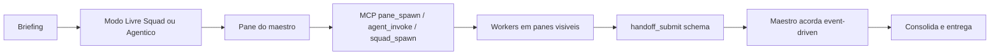

# Destilação Overclock 1.2.4 — site + DMG + RE do sidecar

**Data:** 2026-08-02  
**Fontes:**
- Site público `https://overclock.sh` (Firecrawl: 100 páginas do domínio + 67 aulas)
- DMG `~/Downloads/Overclock_1.2.4_aarch64.dmg` (montado RO em `/tmp/overclock-124`)
- Sidecar bytenode `Resources/sidecar/dist/index.jsc` (SHA-256 `be63c4913a012767cf2dd14300019609b9c18c2ad3a6db993c3d20b4339b46e7`, ~3.0 MB)
- Assinatura: Developer ID Guilherme Laschuk (`T4BPBR7L76`), timestamp 29 Jul 2026 20:33
- Releases: `ustoppble/overclock-releases` tag `v1.2.4`

**Nota de instalação corrigida:** `/Applications/Overclock.app` está em `1.2.4`.
Executável, loader e bytecode instalados são idênticos aos do DMG. SHA-256 do
DMG: `21db9339b306158ac3f774777b7f57bdbccf97f9da3ccbddee90efdafe3bb8ba`.

---

## 1. Tese do produto (site)

Overclock se posiciona como **ADE** (Agentic Development Environment), não IDE:

1. **Briefing** — texto ou voz, sem formulário pesado  
2. **Squad / maestro** — reparte, cobra, junta  
3. **Entrega** — panes visíveis + custo em tempo real  

Slogan operacional: *“Delegar é a regra — executar é proibido”* (maestro sem edit/shell).  
Filosofia: *“Não jogamos prompt em modelo — montamos o harness”*.

Modelo de negócio: **cockpit por assinatura**; tokens/modelos ficam nas CLIs já pagas pelo usuário (Claude Code, Codex, Gemini, Antigravity, OpenRouter, locais…).

### Planos (site, PT-BR, ago/2026)

| Plano | Cheio | Promo 50% (3 meses) | Desbloqueia |
|-------|-------|---------------------|-------------|
| Boost | R$ 97/mês | R$ 48,50 | Cockpit, multi-pane, custo, agentes/skills (modo Livre) |
| Boost Pro | R$ 197/mês | R$ 98,50 | + Squads, Receitas, ClockVoice, PT↔EN |
| Ultra | R$ 397/mês | R$ 198,50 | + Jarvis, harness automático, missão agêntica, Redline |

Garantia 7 dias / Stripe Portal.

### 15 superfícies anunciadas

Panes · Missões · Agentes · Skills · Marketplace · MCP · Providers · Workspace · Media · OverMemory · Squad · Receitas · ClockVoice · Harness · Jarvis (+ Redline no Ultra).

### Squads “Overclock Original” (resultado-first)

| Squad | Resultado de marketing | Pico anunciado |
|-------|------------------------|----------------|
| Cinema Site | Landing cinema-grade | ~9 panes, 2 gates |
| App Factory | App web com seed | ~8+ panes, 3 gates |
| SaaS 10K | SaaS + auditoria | ~12+ panes, Factory+2 |
| Autopilot | Cron + alarme | N+1 panes, 3 gates |
| Arcade | Jogo jogável | 7 panes, 3 gates |

---

## 2. Loop operacional (o que “funciona de verdade”)

### Três modos de missão (site + binário)

| Modo | Quem orquestra | Plano |
|------|----------------|-------|
| **Livre** | Usuário abre panes | Boost+ |
| **Squad** | Maestro + roster preset | Pro+ |
| **Agêntico** | Piloto + chefes (Cadeia ou Torre) | Ultra |

**Chefes (Agêntico):** scout · builder · reviewer · controller (Torre).  
Gate: só o piloto da missão agêntica invoca chefe (string no binário confirma recusa fora desse papel).

### Mecânica que evita o “cola contexto”

- Maestro **sem** ferramentas de edição/shell → obrigado a delegar  
- Workers fecham ~30s após handoff limpo (opt-in / F-295 coleta no done da missão)  
- Handoffs **duráveis** em SQLite (`handoffs` table no sidecar)  
- `pane_write_many` serializa writes no mesmo pane (F-292)  
- `requireHandoff` + footer de contrato injetado no brief  
- Schema validation em artifacts → re-prompt de correção  

---

## 3. Arquitetura (RE do DMG 1.2.4)

| Camada | Evidência |
|--------|-----------|
| Shell UI | Tauri 2.11.2, binário `MacOS/overclock` (~18 MB) |
| Runtime Node | `MacOS/node` (~110 MB) + `sidecar/bin/node` |
| Core | Sidecar `@overclock-app/sidecar` → `dist/index.jsc` (bytenode) |
| IPC | WebSocket host (`ws`) “serving Overclock core for Tauri migration” |
| MCP | Servidor embutido; tools `mcp__overclock__*` injetadas no spawn da CLI |
| Catalog/bus/pty | Packages workspace (`@overclock-app/{core,mcp,pty,catalog,bus,ipc-types}`) **vendidos compilados no blob**, não como `node_modules` abertos |
| Engine Node | `>=22.12.0` |
| License | `/api/license/verify`, gates Boost Pro / Ultra no sidecar |
| Voz | ClockVoice (Pro), Jarvis route `/api/v1/jarvis/route` (Ultra), kill-switch `OVERCLOCK_JARVIS` |

Topologia observada com o app aberto:

- Tauri → sidecar Node/Bytenode
- MCP SSE: `127.0.0.1:51737`
- WebSocket do core: `127.0.0.1:51002`
- RemoteBridge: `0.0.0.0:8789` via WSS
- Porta local `17778`, correlacionada no binário a `DEV_AUTH_PORT`

O shell contém o hash esperado de `index.jsc` e o caminho
`sidecar_integrity_failed`, indicando verificação de integridade antes do
bootstrap. O Tauri também supervisiona queda do sidecar e emite
`app:sidecar-restarted`.

### Superfície MCP / API interna (strings 1.2.4)

Grupo **pane:** `pane_spawn`, `pane_write`, `pane_write_many`, `pane_read`, `pane_read_many`, `pane_list`, `pane_list_providers`, `pane_wait_idle`, `pane_wait_many`, `pane_close`, `pane_whoami`  

Grupo **handoff:** `handoff_submit`, `handoff_list`  

Grupo **missão:** `overclock_mission_create`, `_get`, `_list`, `_set_status`, `_mission_spawn_pane`  

Grupo **squad/agente:** `overclock_squad_{get,list,save,spawn}`, `overclock_agent_{get,list,invoke}`, `overclock_task`, `overclock_workflow`, `overclock_clarify`  

Grupo **catálogo/receita:** `catalog_*`, `marketplace_search`, `recipe_{list,get,save}`, `skill_list`, `stack_get`, `model_list`  

Grupo **cron:** `cron_create`, `cron_list`, `cron_delete`  

Grupo **mídia:** `image_generate`, `video_generate`, `audio_generate`, `media_providers`, `open_browser`, `navigate`  

Grupo **memória:** `memory_remember/recall/forget`, `overclock_memory_read/write`  

Grupo **observação (QA do próprio app):** `app_status`, `app_watch`, `app_screenshot`, `app_events`, `app_pane_contents`, `app_observe_once`  

Inventário bruto: [`_overclock-124-mcp-surface.txt`](./_overclock-124-mcp-surface.txt).

O site anuncia **52 tools** (46 core + 6 diagnóstico). A negociação MCP viva
contra o app 1.2.4 retornou **51 tools** para uma sessão de auditoria; o
`app_status` interno reportou **49**. A superfície é contextual/filtrada por
caller, mas a contagem pública não é uma invariável do runtime.

---

## 4. Segurança (o que existe vs o que não)

**Presente no binário:**
- `requireHandoff`
- Skill whitelist / `PreToolUse` / `claudeSkillGate` (por pane)
- Flags CLI `--yolo`, `--dangerously-skip-permissions`, `--sandbox`, `--approval-mode`, `bypassPermissions`
- Human-approval gates em receitas (`after` + `ask`)
- Escopo de `pane_close` (missão/workspace; não fecha o caller por default)
- License / plan gates
- Release gate, resource gate e dangerous-command gate
- Cross-workspace/cross-mission exige opt-in explícito
- Handoff pode carregar comandos, exit codes, arquivos, deploy, wiring e teste
- App assinado, notarizado e updater Tauri com manifesto assinado

**Ausente / não enforced como no Nexus:**
- Sem Seatbelt / Bubblewrap / OCI de OS nos panes  
- Autonomia-first: bypass/yolo são caminhos de produto, não exceção  
- Builtins de squad **re-sincronizam a cada boot** (site: “atualizados automaticamente”) — o oposto do hash imutável pós-aprovação do Nexus  
- Sem entitlement `com.apple.security.app-sandbox`
- Política observada `write_external` permite acesso fora do workspace
- RemoteBridge escuta em todas as interfaces
- `session.json`, contendo access/refresh tokens, está em modo `0644`; o
  resource gate observado protege `service-keys`, não esse arquivo

**Conclusão de segurança:** Overclock tem enforcement real na camada de
orquestração, mas não uma fronteira forte contra um processo local hostil com
shell. Blast radius de OS fica com a CLI nativa. A lição para o Nexus é copiar
a ordem dos gates, não esse blast radius.

---

## 5. Harness (produto + binário)

Bundle por **tipo de task**: agente + skills + CLI + modelo + effort.  
Precedência determinística (site): **roster > invoke > default do catálogo**.  
Receitas = formações prontas com steps, media tiers, fan-out e gates humanos (`recipe_get` no start de `[RECIPE-RUN]`).  
`overclock_task` / `overclock_workflow` = runtime determinístico (JSON-Schema em artifacts).

---

## 6. Delta 1.2.2 → 1.2.4 (observável)

| | 1.2.2 (Applications, 24/jul) | 1.2.4 (DMG, 29/jul) |
|--|------------------------------|---------------------|
| `index.jsc` size | 2.831.072 bytes | 3.158.264 bytes (+327.192) |
| Timestamp codesign | 24 Jul 11:00 | 29 Jul 20:33 |

O Node empacotado e as skills permaneceram iguais. Houve atualização de SDKs
e dependências (`claude-agent-sdk`, Anthropic SDK, MCP SDK, Hono e `jose`).
Novos literais e schemas confirmam reforço em mission binding, handoff durável,
wake delivery, recuperação de drafts e recusa explícita de skill gaps.

---

## 7. Cruzamento duro com Nexus (por que eles “vivem” e nós não)

| Dimensão | Overclock 1.2.4 | Nexus hoje |
|----------|-----------------|------------|
| Happy path | Brief → spawn → handoff | Approve → 20+ gates → spawn → recovery |
| Falha permanente | Pane/status / reaprovar | Retry técnico infinito (até o freio recente) |
| Squad builtin | Sync no boot é feature | Sync no boot invalida `squadRevisionHash` |
| Maestro | Sem edit/shell (gate simples) | Cascata de selos + singleflight + lifecycle locks |
| Sandbox OS | Não é pré-requisito do spawn | Seatbelt/etc. no caminho crítico |
| Empacote | Tauri + sidecar Node 22 | Electron + nativos (ABI hell) |
| Produto | Resultado publicado (squads com cases) | Missão quase nunca nasce |

**Lição estratégica (não é “copiar Overclock”):**  
Manter enforcement **depois** que o PTY existe. Antes disso, só gates que o vibe coder entende em uma frase (reaprovar / pasta suja / login CLI). Qualquer hash/CAS/PREVC que impeça o primeiro pane é dívida de produto disfarçada de segurança.

### Gates do Nexus confirmados no caminho pré-worker

O cruzamento de código encontrou pelo menos **25 gates** antes do primeiro
worker, ou na sua entrada imediata. Eles se agrupam em:

1. workspace + intenção + dispatch authority
2. guided plan + baseline git
3. squad vivo + `squadRevisionHash`
4. runtime exato + authority seal/PREVC
5. reconciliação de pane, sessão física e kickoff
6. anexos + credential probe + modelo + release qualification
7. worktree + RouteReservation + dispatcher + `maxWorkers`
8. lifecycle lock + classificação terminal/recovery

Manter: sandbox de OS, bearer MCP, secrets, credential probe, worktree,
RouteReservation e renderer fora da autoridade de spawn.

Mover para pós-PTY ou simplificar: guided plan seal completo, PREVC freeze,
seal de muitos campos, igualdade cosmética de runtime e hash contra builtin
vivo. A aprovação deve materializar um `mission-runtime-*` imutável e o
bootstrap deve consumir esse snapshot.

---

## 8. O que ainda exige execução ao vivo

O app estava autenticado e o MCP real foi negociado sem expor tokens. Não foi
disparada missão paga ou geração externa para evitar custo e mutação. Ainda
faltam:

- Paywall real (quais tools somem no Boost vs Pro)
- Fluxo Jarvis/ClockVoice end-to-end  
- Squads Original rodando (telemetry de panes/gates)  
- APIs autenticadas (`/api/v1/squad/decide`, license verify payloads)
- Cron com sleep/restart/missed run/retry
- Restore local, worktree e SSH/VPS após queda
- Pairing, expiração, brute force e revogação do RemoteBridge

Se quiser a segunda onda: logar no app 1.2.4 + uma missão Livre mínima + uma Squad Pro (se tiver plano).

---

## 9. Artefatos locais desta destilação

- Este arquivo  
- [`_overclock-124-mcp-surface.txt`](./_overclock-124-mcp-surface.txt) — nomes extraídos do jsc  
- DMG fonte: `~/Downloads/Overclock_1.2.4_aarch64.dmg`  
- Auditorias anteriores no repo: `2026-07-13-overclock-harness-mcp-jarvis-senior-audit.md`, `2026-07-18-analise-senior-nexus-vs-overclock-orca-omp.md`
