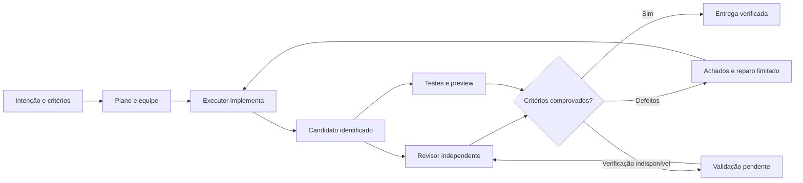

# Nexus para quem não programa: comparação e plano de evolução

Data: 7 de setembro de 2026. Base Nexus: `0.76.3`, commit `3c61b14904594b29675df7cdd55edde6c4bc4e56`, mais as correções locais descritas abaixo.

## Parecer de engenharia

O Nexus já tem uma base ampla de orquestração, isolamento, contexto, design e recuperação. O maior problema para o produto pretendido é a **confiabilidade da entrega**: os caminhos atuais ainda não dão a mesma garantia de que outra inteligência examinou o código final, que os testes passaram e que o resultado funciona para o usuário.

A prioridade é fazer uma pessoa sem conhecimento técnico conseguir **descrever, acompanhar, experimentar e pedir ajustes**, enquanto o motor assume planejamento, implementação, revisão e recuperação. A quantidade de CLIs, ferramentas ou arquivos MD não mede esse resultado.

**Ainda não há evidência para declarar o Nexus superior aos três concorrentes ou pronto para comercialização.** Esta análise identifica vantagens documentadas, falhas reproduzidas, correções iniciais e critérios objetivos para demonstrar superioridade. Não foi executado um benchmark equivalente nos quatro produtos.

## O que foi comparado

| Produto | Referência verificada | Limite da evidência |
|---|---|---|
| NexusIDE | Código, testes e contratos deste checkout | Não é certificação do aplicativo empacotado nem teste com usuários leigos |
| Orca, StablyAI | Repositório MIT, documentação oficial e release desktop **1.4.197**, 04/09/2026, commit `5ee4ace` | Docs atuais podem descrever recursos posteriores ao binário; não foi executado o concorrente |
| Overclock local | `/Applications/Overclock.app/Contents/Info.plist`: **1.3.18**; recursos distribuídos e metadados do sidecar | Core distribuído em bytecode; strings e playbooks não provam funcionamento em execução |
| BridgeSpace local | `/Applications/BridgeSpace.app/Contents/Info.plist`: **3.4.18** | Metadados locais e notas oficiais; sem missões executadas nesta análise |
| BridgeMind atual | Oferta e documentação de **Agent / Code / Chat**, sucessora do BridgeSpace | Comparação complementar: não atribuir automaticamente seus recursos ao BridgeSpace instalado |

Fontes de versão: [Orca 1.4.197](https://github.com/stablyai/orca/releases/tag/v1.4.197), [BridgeSpace 3.4.18](https://www.bridgemind.ai/changelog/bridgespace/v3-4-18), [BridgeMind atual](https://www.bridgemind.ai/).

Uma comparação anterior que atribua multi-account ao BridgeSpace precisa ser corrigida: a versão 3.4.17 removeu perfis por pane e troca automática por limite. Isso não elimina a utilidade do recurso no Nexus; apenas impede usar uma capacidade retirada como vantagem atual do concorrente. [Nota oficial 3.4.17](https://www.bridgemind.ai/changelog/bridgespace/v3-4-17).

## Comparação por resultado para o usuário

| Dimensão | Orca | Overclock 1.3.18 local | BridgeSpace / BridgeMind | Situação e prioridade do Nexus |
|---|---|---|---|---|
| Começar sem saber programar | Jornada documentada ainda usa repo, worktree, agentes e diff | Receitas e playbooks orientados a site/app/SaaS | BridgeMind separa intenção em Agent, Code e Chat | Existe Caminho Expresso, mas sua primeira tela ainda pede escolher ferramenta por papel. Tornar a equipe recomendada suficiente e a edição opcional |
| Coordenar vários agentes | Orquestração estruturada experimental, tarefas com dependências e tentativas identificadas | Handoffs e equipes especializadas descritos nos recursos | Sessões/papéis e presets; não comprovam sozinhos revisão obrigatória | Motor real já existe. Consolidar as condições de conclusão, sem criar outro orquestrador |
| Uma IA julgar a outra | Revisão de diff e retorno ao agente documentados; não foi demonstrado gate obrigatório universal | Política de hunter/skeptic/applier e evidências nos playbooks | Não foi demonstrado gate universal de qualidade nas fontes consultadas | Gate independente existe, mas aceita prosa como evidência; Via Rápida pode concluir com scanner sem outra LLM |
| Retomar trabalho | Daemon preserva PTYs ao fechar a UI; reboot é outro caso | Recuperação e TTL descritos no pacote; doctor local trata órfãos/travamentos | BridgeSpace documenta identidade durável e circuit breaker de restore | Há journal, handoffs e recovery. Falta medir perda, duplicação e intervenção após falhas equivalentes |
| Ajustar visualmente | Design Mode captura elemento, CSS e screenshot para o agente | Fluxos de direção de arte, assets e revisão visual | Browser junto à execução; plugins de mídia na oferta atual | Design Mode e contratos já existem. Priorizar comentário sobre o resultado e verificação do ajuste |
| Sites distintos com motion | Ferramentas visuais não são garantia estética | Playbooks de landing e cinema já presentes também no Nexus | Não foi comprovado pipeline que garanta identidade ou motion de qualidade | MDs precisam chegar ao runtime, respeitar a identidade do projeto e ter sua aplicação verificada em navegador |
| Skills atualizadas | Guias ligados ao binário e atualização versionada documentados | Arsenal distribuído de design e qualidade | Skills e plugins são apresentados separadamente | Materialização existe, mas helpers podiam ficar antigos quando só o SKILL.md era comparado; correção nesta rodada |
| Escolher o melhor modelo | Lançar várias CLIs não comprova equivalência semântica entre elas | Recursos reconhecem limitações de modelos/CLIs | Algumas integrações são chat estruturado; outras, terminal | Benchmark publicado por especialidade está vazio. Roteamento heurístico não prova “melhor LLM” |
| Entregar algo verificável | Preview, diff e ferramentas de revisão integrados | Evidências exigidas nos prompts, com limites de enforcement não auditáveis | Browser junto ao trabalho; catálogo não prova deploy completo | Há gate final, porém listas declaradas e texto podem passar sem artefato real. Corrigir antes de vender entrega autônoma |

Fontes Orca: [primeira sessão](https://www.onorca.dev/docs/first-session), [orquestração](https://www.onorca.dev/docs/cli/orchestration), [restore](https://www.onorca.dev/docs/model/session-restore), [Design Mode](https://www.onorca.dev/docs/browser/design-mode), [skills](https://www.onorca.dev/docs/cli/skills). Fontes BridgeMind: [Code Mode](https://docs.bridgemind.ai/docs/code-mode), [Agent Mode](https://docs.bridgemind.ai/docs/agent-mode), [skills e plugins](https://docs.bridgemind.ai/docs/skills-and-plugins), [restore BridgeSpace 3.4.13](https://www.bridgemind.ai/changelog/bridgespace/v3-4-13).

As oportunidades da última coluna são conclusões desta auditoria. Ausência de prova pública de um recurso do concorrente não significa que ele não exista.

## O que já existe e merece ser preservado

- `MissionEngine`, contrato de intenção e `completeVerifiedMission`: há um limite compartilhado para endurecer a conclusão.
- Handoffs duráveis, dispatches, recibos e journal: base para recuperar sem repetir efeitos.
- Adapters declarativos, fallback e política de capacidades: base para heterogeneidade de CLIs.
- Contrato visual em `DESIGN.md` ou `.context/docs/design-system.md`, bootstrap e seleção de referência: base para preservar a identidade de cada projeto.
- Browser, preview e revisão vinculada ao checkout: base para verificar o resultado renderizado.
- Testes co-localizados, segurança de IPC e gates de release: infraestrutura de validação já disponível.

Na comparação dos recursos distribuídos, os playbooks e arquivos correspondentes de `absurd-landing`, `cinema-site`, `qa-swarm`, `qa-vision` e `squad-former` já são iguais aos do Overclock nos grupos examinados. **Copiar esses mesmos prompts outra vez não cria vantagem.** O arsenal mais recente do Overclock inclui pacotes como `oc-design-dna`, mas o Nexus já possui soluções próprias para parte de suas funções.

O `oc-design-dna` local traz proveniência de decisões, camadas de tokens, estados e lint de artefatos. Esse é um aprendizado útil de processo; o lint observado ainda usa verificações declarativas e não certifica interação ou estética. Integrar critérios ao motor existente é preferível a duplicar o subsistema. Origem e permissão de redistribuição dos recursos já incorporados devem ser comprovadas no gate de licenças da release; esta rodada não incorporou código ou assets dos concorrentes.

## Falhas concretas e sua consequência

| Prioridade | Constatação | Evidência no Nexus | Tratamento |
|---|---|---|---|
| Alta | Aprovação automática podia sobreviver a mudanças sem commit | Cache `approvedMemo` por missão + HEAD retornava antes do scanner e sensores em `civilian-auto-review.ts` | **F-132**, cache removido; regressões testadas |
| Alta | Resumo longo equivale a evidência de revisão | `reviewerHandoffHasEvidence` aceita 80 caracteres sem prova; `summary = 'x'.repeat(80)` passa | **F-134**, aberto: recibo verificável ligado ao candidato |
| Alta | Uma reprovação antiga bloqueia a versão corrigida | Gate procura qualquer revisão negativa no histórico antes de considerar aprovação; produção passa `includeDelivered: true` | **F-135**, aberto: rodadas/candidatos e substituição explícita de achados |
| Alta | Um “Pronto” pode satisfazer o gate de arquivos | `evaluateDeliveryArtifactsForDone`: objetivo “Crie uma loja em loja/”, raiz inexistente, handoff success com texto retorna `ok` | **F-136**, aberto: contrato de entrega e artefatos físicos |
| Alta, produto | Via Rápida não garante revisão por outra LLM | `isCivilianViaRapidaReviewExempt`, `civilianAutoReviewGate`; scanner aprovado ou indisponível pode seguir com nota | Unificar o contrato de qualidade das missões que criam software |
| Média/alta | Erro JSON do npm audit aparecia como auditoria aprovada | `{ "error": { "code": "ENOLOCK" } }` produzia laudo sem vulnerabilidades | **F-403**, validação do relatório nesta rodada |
| Média | Atualização de helper de skill podia não chegar ao agente | `materializeManifestSkill` comparava apenas SKILL.md | **F-133**, cache gerado e novas cópias corrigidos; instalações já existentes nos perfis são preservadas |
| Alta | Atalho de conclusão pode seguir depois de revisão mandar aguardar reparo | Watcher chama `maybeApplyCivilianPronto` após resultado não concluído do reconciliador | **F-137**, aberto; risco identificado por rastreamento, ainda sem reprodução E2E |
| Alta | Scanner usa diff commitado para algumas regras enquanto lê arquivos atuais | `candidate-quality-scanner.ts`: diff base→HEAD e mapa `addedLines`; análise parcial pode seguir no caminho civil | **F-138**, aberto: analisar e vincular o candidato completo |
| Média | Tentativas simultâneas podem repetir sensores caros | Watcher de 15s e idle-delivery chamam reconciliação; sensores têm timeouts maiores | **F-139**, aberto: serialização por missão com revalidação de autoridade |

Os caminhos acima ficam em `src/main/orch/`, exceto os sensores em `src/main/context/mechanical-sensors.ts`. Reproduções e limites estão nos respectivos [findings de QA](../qa/items/).

**Limite importante da primeira correção:** refazer o scanner elimina a reutilização indevida de aprovação. Isso não torna o scanner uma revisão semântica por outra LLM, não sela um snapshot imutável durante toda a verificação e não corrige os outros atalhos. Algumas regras ainda usam linhas do diff commitado, então reexecutar a análise não garante detectar todo defeito sem commit. Similarmente, devolver `unavailable` para auditoria inválida melhora a veracidade do laudo; a política civil atual ainda permite prosseguir com verificações indisponíveis.

## A experiência que o Nexus deve entregar

O fluxo principal deve caber em cinco momentos:

1. **Descrever:** “Quero um sistema de agendamento para minha barbearia.” Texto, voz e referências. Perguntas apenas sobre decisões que mudam o produto.
2. **Combinar a entrega:** mostrar o que será criado, o que fica fora, como será testado e o limite de gasto. Equipe recomendada automaticamente; configuração técnica em detalhes.
3. **Acompanhar:** “Criando o agendamento”, “Conferindo login”, “Testando no celular”. Explicar bloqueios e o que foi preservado. Terminal acessível sob demanda.
4. **Experimentar:** preview funcional com exemplos de uso; comentar em um elemento ou dizer “deixe mais simples”. Ajuste entra no mesmo ciclo de revisão.
5. **Entregar:** o que funciona, quais verificações passaram, pendências, versão restaurável e ação de publicar quando o destino estiver preparado.

Hipótese de usabilidade: isso reduz a necessidade de entender CLIs, modelos e Git. Ainda deve ser testada com pessoas leigas. A inspeção desta rodada foi de código e contratos, sem uma nova avaliação visual em execução ou teste moderado.

O texto atual “Descreva e pronto”, em `ExpressMissionStart.tsx`, é seguido da escolha da ferramenta por papel e da lista completa de agentes. A capacidade avançada pode continuar, mas não deve ser um pré-requisito cognitivo para começar. O foco da home deve ser o projeto e sua próxima entrega, conforme a intenção já registrada em `PRODUCT.md`.

## Contrato de orquestração para trabalho de qualidade

Proposta para consolidar os mecanismos existentes, sem construir outro motor:



O candidato deve identificar a intenção, a tarefa/tentativa, o conteúdo do checkout incluindo alterações sem commit e os artefatos. Cada revisão precisa apontar para esse candidato, identificar seu autor e ligar os critérios a evidências existentes. Alterou o conteúdo relevante: a revisão anterior deixa de autorizar a entrega.

O autor e o revisor devem ser sessões distintas. Provedor/modelo diferente é uma preferência útil quando houver capacidade e orçamento, mas dois nomes diferentes não garantem bom julgamento. O revisor precisa examinar a entrega, ter critérios claros e apresentar achados verificáveis. Testes e inspeção do produto complementam a opinião da LLM.

Uma reprovação gera achados identificados. A correção seguinte referencia esses achados e produz outro candidato; a aprovação não apaga o histórico nem permite que uma revisão de outro trabalho encerre a tarefa atual. Limites de tempo/custo e reparo evitam loops, e a falta de verificador produz “validação pendente”, com substituição automática quando possível.

Consulta factual simples continua tendo entrega textual. Criação, edição, exclusão de arquivos e operação remota precisam de tipos de evidência distintos. Por isso a correção do gate de artefatos deve partir do contrato da missão: adicionar outra regex ao texto do objetivo não resolve todas essas situações e pode bloquear entregas legítimas.

## Design e motion: o que precisa mudar

**Um pacote coerente por tarefa.** Usuário e contrato aplicado do projeto têm precedência; a direção visual fornece referências; skills especializadas ensinam execução. Registrar versão/hash do pacote efetivamente carregado e resultado da revisão. Evitar despejar dezenas de instruções incompatíveis no prompt.

A correção F-133 atualiza o cache gerado e abastece novas cópias. Não sobrescreve instalações de skills já existentes nos perfis CLI, inclusive as anteriormente entregues pelo Nexus. Atualização gerenciada dessas instalações exige distinguir conteúdo original de personalizações; não foi implementada nesta rodada.

Há conflito textual verificável entre `.devin/skills/landing-page-design/SKILL.md` e as instruções de design do runtime: a primeira obriga título com gradiente, navegação em glass pill e entrada invisível; `DESIGN_CHARTER`/Impeccable rejeitam gradiente de texto e glass como padrão. Impeccable também exige conteúdo visível por padrão. A skill local não está provada como carregamento universal de toda missão, portanto o achado é uma inconsistência de orientação, não prova de que todos os agentes recebem ambas. A correção de produto deve explicitar precedência e retirar composições obrigatórias de uso universal.

**Direção antes do código.** Para um site novo: público, oferta, referências, paleta, tipografia, composição, imagens e movimento. Produzir alternativas somente quando a direção estiver incerta; reaproveitar a identidade quando ela já existir. Uma landing de restaurante, uma marca de moda e um SaaS não devem herdar a mesma estrutura só porque compartilham a mesma skill.

**Motion verificável.** Definir para cada movimento o objetivo, gatilho, início/fim, duração, comportamento no celular e alternativa reduzida. Microinterações podem usar CSS; sequências narrativas podem justificar uma biblioteca ou mídia especializada. Não fixar uma biblioteca nem um hero cinematográfico em todo projeto. Os playbooks de cinema já existem; a lacuna é seleção e verificação no fluxo padrão.

**QA visual que exercita o resultado.** Hoje a sessão de revisão exige read + screenshot e restringe navegação, click e type (`cli-automated-reviewer.ts`, `automated-review-session.ts`). Isso ajuda a confinar a revisão, mas não prova todos os itens pedidos no próprio prompt, como teclado, estados e reduced-motion. A solução proposta é um executor de testes visuais confinado ao preview/candidato, que produza evidências para o revisor, sem ampliar arbitrariamente a autoridade dele.

Evidência mínima proposta: desktop e celular, caminho principal funcionando, foco/teclado, estados de erro/vazio/carregamento, comparação com a direção visual e amostras temporais da animação. Conteúdo deve continuar acessível quando a animação não roda. Medir fluidez e custo em dispositivo definido, sem chamar uma captura estática de prova de motion.

## Plano de evolução por ondas

| Onda | Entrega | Onde concentrar | Critério para encerrar |
|---|---|---|---|
| **0, esta rodada** | Comparação e correções de cache, laudo de audit e atualização de skills | Módulos existentes + testes + QA | RED/GREEN, typecheck, revisão e diff limpo |
| **1, prioridade máxima** | Uma regra de qualidade para toda criação de software | MissionEngine, completion, review/evidence e contratos compartilhados | Nenhum `done` por prosa, evidência ausente, candidato desatualizado ou verificação indisponível |
| **2** | Loop automático de crítica e reparo | Dispatches, findings, recovery e roteamento atuais | Defeito plantado é achado, corrigido e reavaliado; rejeição antiga não prende candidato corrigido; falha de CLI não duplica tarefa |
| **3** | Jornada leiga orientada a resultado | Setup, MissionBoard, preview e entrega | Leigos concluem tarefas sem escolher branch, rodar comandos ou interpretar diff |
| **4** | Design com identidade e motion testado | Contratos, skill-mirror, browser e QA visual | Três briefs diferentes produzem composições distintas, responsivas e com movimento verificável |
| **5** | Beta comercial e benchmark comparativo | Eval existente, instalação, atualização e checklist de release | Resultados repetidos, critérios de qualidade atingidos e pacote validado nas plataformas anunciadas |

A ordem coloca confiança na entrega antes de ampliar promessas. Onda 1 deve cobrir também os caminhos manuais de conclusão automática. Override humano explícito precisa continuar distinto de “verificado pelo sistema”. As ondas são propostas de trabalho; apenas a onda 0 está sendo executada nesta rodada.

## Como demonstrar que superamos os concorrentes

Usar o runner e o journal existentes em `src/main/eval/`; não criar outro ranking sem evidências. O arquivo publicado `resources/mission-specialty-benchmark.json` tem `specialties: {}` e fonte `unpublished`. Um overlay local pode existir, mas não foi auditado. Portanto não há neste arquivo um ranking comprovado para a promessa “o Nexus escolhe a melhor LLM”.

Suite inicial proposta, com mesmo prompt, repositório inicial, referências e orçamento por produto:

| Caso | Prova exigida |
|---|---|
| Landing de negócio local | Mobile funcional, contato/agendamento real, identidade e motion com alternativa reduzida |
| Site de marca com direção muito diferente | Avaliação visual cega; não repetir composição e estilo do primeiro |
| CRUD com login | Persistência, autorização, validação, erro e sessão expirada |
| SaaS com duas organizações | Dados isolados e testes negativos de acesso cruzado |
| Correção em projeto existente | Preservar comportamento anterior e demonstrar o bug corrigido |
| Revisor indisponível | Recuperar ou mostrar validação pendente; nunca aprovação fictícia |
| Código alterado depois da revisão | Recusar a evidência antiga e revisar o candidato novo |
| Rejeitar, corrigir e aprovar | Resolver a rodada correta, manter histórico e concluir |
| Worker/CLI encerrado após entrega | Recuperar resultado sem executar efeitos duas vezes |
| Quota esgotada | Substituir dentro das capacidades e do orçamento ou explicar o bloqueio |
| Pasta vazia com agente dizendo pronto | Impedir a conclusão do pedido de software |
| Consulta simples sem arquivos | Responder sem exigir pipeline de construção |

Registrar: versões dos apps/CLIs/modelos/skills, artefatos, comandos e exit codes, custo, tempo até primeiro preview utilizável, intervenções técnicas, falhas e recuperações. Repetir pelo menos três vezes por caso como triagem inicial; ampliar amostra antes de alegação comercial. Uma avaliação cega de código e visual deve ser separada do julgamento do próprio agente autor.

Metas propostas para o beta, ainda **não medidas**: zero conclusão falsa nos casos negativos; zero falha crítica de segurança nos cenários testados; pelo menos 80% das tarefas do conjunto concluídas sem intervenção técnica; cinco participantes leigos conseguindo iniciar, entender progresso, experimentar e pedir ajuste; taxa de sucesso superior aos concorrentes dentro do mesmo orçamento. Reportar custo e tempo junto da qualidade, não apenas uma média que esconda falhas críticas.

“Qualquer LLM” deve significar arquitetura extensível e uma matriz de capacidades verificadas: iniciar, usar ferramentas, emitir saída estruturada, retomar, cancelar, receber imagens e revisar. LLM sem capacidade necessária não recebe silenciosamente um papel que não consegue cumprir. Publicar quais combinações foram ensaiadas e separar experimental de validado.

## Validação desta rodada e limites

Três correções implementadas e verificadas por um segundo agente: [F-132](../qa/items/F-132.md), [F-133](../qa/items/F-133.md) e [F-403](../qa/items/F-403.md). Cada uma teve regressão RED antes do reparo e GREEN depois. As mudanças permanecem locais, sem commit ou publicação.

- **240 testes passaram em 11 arquivos**, incluindo os três módulos alterados, seus chamadores e verificações relevantes de autoridade MCP, entrega de skills e revisão visual.
- `npm run typecheck`: passou no estado final.
- `npm run security:renderer-sinks`: **0 executable DOM sinks**.
- `git diff --check`: passou; links locais do relatório e hashes dos arquivos testados conferidos.
- CodeRabbit, `review --agent -t uncommitted`: **0 findings** na revisão final dos seis arquivos de fonte/teste alterados. A revisão independente adicional encontrou a inconsistência de contagens de auditoria, que foi corrigida e revalidada.
- Ambiente de validação: Node **22.22.3**, npm **12.0.2**. Resultados por arquivo e hashes do código final em [verification.json](../qa/evidence/2026-09-07-autonomy-audit/verification.json).

Comando da bateria final:

```sh
npx vitest run \
  src/main/orch/civilian-auto-review.test.ts \
  src/main/orch/civilian-delivery-completion.test.ts \
  src/main/context/mechanical-sensors.test.ts \
  src/main/orch/skill-mirror.test.ts \
  src/main/orch/cli-mcp-session-governance.test.ts \
  src/main/orch/guided-squad-skills.test.ts \
  src/main/orch/mcp-dispatch-security.test.ts \
  src/main/context/automated-review-design-contract.test.ts \
  src/main/orch/mission-independent-review-gate.test.ts \
  src/main/orch/mission-delivery-artifact-gate.test.ts \
  src/main/context/candidate-quality-scanner.test.ts
```

Testes existentes verdes não eliminam as lacunas documentadas: alguns ainda refletem contratos permissivos, como aceitar lista de artefatos apenas declarada. F-134 a F-139 permanecem abertos; não foram corrigidos por essas três mudanças.

O relatório não atesta cobertura global de 80%, teste E2E com CLIs reais, benchmark competitivo, UX intuitiva em uso ou release pronta. Os critérios de instalação, assinatura, smoke, segurança e licenças continuam no [checklist de release](../RELEASE-CHECKLIST.md).
